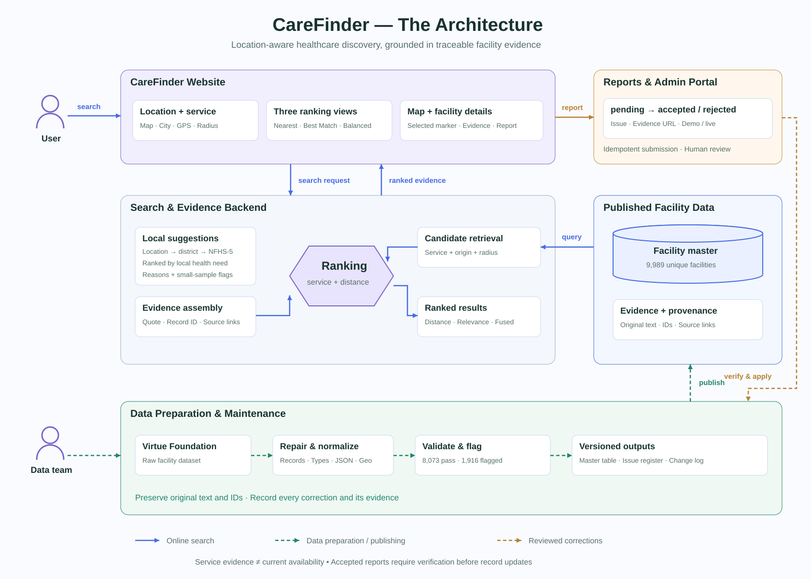

# CMU Datathon

Finding a nearby hospital does not guarantee that it offers the care a patient needs. **CareFinder** helps users discover healthcare facilities by location and service, compare their documented capabilities, and understand the evidence behind every recommendation.

Instead of treating missing information as unavailable care, CareFinder makes uncertainty visible.

## What CareFinder Does

- **Service-based search:** Find facilities by healthcare service, city, coordinates, or current location within a customizable radius.
- **Three transparent rankings:** Compare facilities by **Nearest**, **Best Match**, or **Balanced**.
- **Explainable recommendations:** Inspect original facility quotations, readiness evidence, uncertainty levels, and ranking explanations.
- **Location-aware suggestions:** Recommend relevant services using district-level health indicators from NFHS-5 [8].
- **Interactive mapping:** Explore facilities through a Leaflet map with distance visualization and street-level detail.
- **Community feedback:** Report incorrect information and support administrator review with traceable corrections.

## System Architecture

CareFinder combines offline data processing with evidence extraction, service-readiness assessment, and fast geographic search.

### 1. Data Cleaning & Quality Auditing

The pipeline reconstructs malformed CSV records, removes exact duplicates, normalizes structured fields, and preserves unresolved discrepancies. Data-quality checks distinguish structural validity from factual verification, following principles reflected in WHO's Data Quality Review framework [4].

- **9,989** unique healthcare facilities after deduplication.
- **30** fragmented facility records reconstructed from 88 CSV fragments.
- **28** structured fields normalized for JSON compatibility.
- **8,073** facilities pass the current quality rules.
- **1,916** facilities retain unresolved flags requiring further review.

Every change is tracked through validation results and audit logs. Passing quality rules does **not** imply that all facility information has been independently verified.

### 2. Evidence Extraction & Readiness

CareFinder uses **DeepSeek-based structured extraction** [11] alongside deterministic rule-based matching to analyze facility descriptions, procedures, equipment, specialties, and capabilities.

The service dictionary covers **186 healthcare services** and **782 resources**. Every extracted claim references an original record item, allowing verbatim evidence to be retrieved without generating quotations.

Service mentions are distinguished from negations, future plans, referrals, and equipment-only references.

The assessment framework draws on established healthcare evaluation methods:

- **Eligibility:** Inspired by WHO EmONC signal-function requirements [2], essential evidence must confirm that the facility itself offers the service.
- **Readiness:** Follows WHO SARA's domain-based approach [1], with service requirements informed by standards such as the PMNDP haemodialysis checklist [6] and IPHS 2022 [7].
- **Evidence certainty:** Uses four GRADE-inspired levels [3], considering evidence strength, internal consistency, and timeliness [4].

Missing evidence remains **unknown**, rather than being treated as proof that a service is unavailable.

### 3. Geographic Search & Ranking

Each search produces three complementary rankings:

| Ranking | Method |
|---|---|
| **Nearest** | Straight-line distance, accounting for unreliable coordinates |
| **Best Match** | Documented service readiness and evidence certainty |
| **Balanced** | Reciprocal Rank Fusion (RRF, k = 60) combining distance and match rankings [5] |

A per-service BallTree using the haversine metric [9] accelerates radius searches. Benchmarking across the full dataset achieved approximately **0.2 ms median query time** and **0.3 ms at the 95th percentile**.

Each result explains why it was ranked, including documented service evidence, missing requirements, and distance-related trade-offs.

The query engine is designed to fit within Databricks Apps compute constraints [10].

### 4. Location-Aware Recommendations

CareFinder uses **NFHS-5 district-level health indicators** [8] to suggest locally relevant healthcare services.

Indicators such as hypertension, blood sugar, anaemia, vaccination coverage, and cancer screening help identify potential regional healthcare needs.

Suggestions reflect **documented local health needs, not search popularity**. Small-sample estimates are explicitly identified.

### 5. Frontend & Feedback

The JavaScript frontend uses **HTML, CSS, JavaScript, and Leaflet**.

Users can search for services, compare ranked facilities, inspect evidence, and submit reports about incorrect information.

The Admin Portal supports report review. In the connected backend, verified corrections are stored with previous values and report IDs for auditability. The standalone frontend preview uses sample reports and temporary review decisions.

## Explore the Demo

- **Facility Search:** Open `CareFinder_Preview.html` in a browser. The sample starts in Jaipur with dialysis selected and includes two fictional hospitals to demonstrate ranking and evidence comparison.
- **Admin Portal:** Open `CareFinder_Admin.html` to explore sample reports and review decisions.

The preview demonstrates the interface without requiring a live backend connection.

## Data Sources

The project uses the Virtue Foundation India healthcare dataset and NFHS-5 [8]:

| Dataset | Scope |
|---|---|
| Healthcare facilities | 9,989 unique facility records |
| Postal reference | 165,625 historical records |
| NFHS-5 district indicators | 706 district-level records |

The postal reference was used in historical processing but is not used for new facility corrections in the current cleaning pipeline.

### Data citations and audit evidence

External citations used for data-quality review and dataset documentation are collected in [data_citations.csv](./data_citations.csv). The table contains source URLs, relevant facility IDs and fields, recorded findings, review dates where available, evidence-access levels, and limitations. It contains citation metadata only, not the full facility or survey datasets.

These are historical, field-specific evidence records. A citation does not imply that a correction was applied or that an entire facility was independently verified. Search-index excerpts are distinguished from directly opened pages; unresolved or conflicting evidence is retained. Multiple facilities may share the same source URL, especially for third-party contact numbers. The table consolidates the available cleaning evidence logs; it is not a complete bibliography of every original dataset record. Methodology references such as WHO SARA, GRADE, and RRF are listed separately below.

## Limitations

CareFinder is an **evidence-based discovery tool, not a medical verification system**.

The facility dataset is not a complete census of Indian healthcare providers. Documented capabilities may not reflect current availability, and missing evidence does not establish that a service is absent. Geographic distances are straight-line estimates rather than travel times.

The platform therefore distinguishes documented readiness, evidence certainty, and unresolved data-quality issues instead of presenting every recommendation as a verified fact.

## References

[1] **WHO — Service Availability and Readiness Assessment (SARA).** Service-specific readiness scoring methodology. [Readiness Indicator](https://www.measureevaluation.org/rbf/indicator-collections/structural-indicators/specific-services-readiness-score)

[2] **WHO — Emergency Obstetric and Newborn Care (EmONC).** Signal-function-based facility eligibility criteria. [Data for Impact](https://data4impactproject.org/?p=5667)

[3] **GRADE — Grading of Recommendations Assessment, Development and Evaluation.** Framework for assessing evidence certainty. [Cochrane](https://www.cochrane.org/node/106)

[4] **WHO — Data Quality Assurance: Module 2.** Desk review of data quality, including consistency and timeliness. [WHO Publication](https://www.who.int/publications/i/item/9789240047389)

[5] **Cormack, G. V., Clarke, C. L. A., & Büttcher, S. (2009).** Reciprocal Rank Fusion Outperforms Condorcet and Individual Rank Learning Methods. *SIGIR 2009*. [Paper](https://plg.uwaterloo.ca/~gvcormac/cormacksigir09-rrf.pdf)

[6] **NHSRC — Pradhan Mantri National Dialysis Programme (PMNDP).** Self-assessment checklist for haemodialysis services. [Official Checklist (PDF)](https://www.nhsrcindia.org/sites/default/files/SELF%20ASSESSMENT%20CHECKLIST%20FOR%20HAEMODIALYSIS%20SERVICES-PMNDP.pdf)

[7] **Ministry of Health and Family Welfare, India.** Indian Public Health Standards (IPHS) 2022, Volume I. [Official Standards (PDF)](https://nhsrcindia.org/sites/default/files/Volume%201_SDH-DH.pdf)

[8] **IIPS & Ministry of Health and Family Welfare, India.** National Family Health Survey (NFHS-5), 2019–2021. [Dataset](https://microdata.worldbank.org/index.php/catalog/4482/study-description) · [District Fact Sheets](https://www.data.gov.in/resource/india-districts-factsheets-national-family-health-survey-nfhs-5-2019-2021)

[9] **scikit-learn.** BallTree documentation for efficient nearest-neighbor and radius searches. [Documentation](https://scikit-learn.org/stable/modules/generated/sklearn.neighbors.BallTree.html)

[10] **Databricks.** Databricks Apps compute sizes and deployment constraints. [Compute Documentation](https://docs.databricks.com/en/dev-tools/databricks-apps/compute-size.html) · [Free Edition Limitations](https://docs.databricks.com/aws/en/getting-started/free-edition-limitations)

[11] **DeepSeek.** API documentation for structured LLM-based evidence extraction. [Official Documentation](https://api-docs.deepseek.com/)
